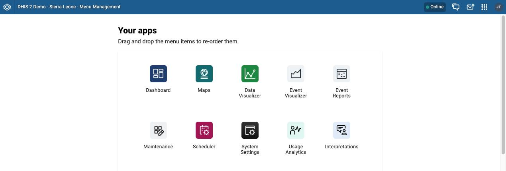
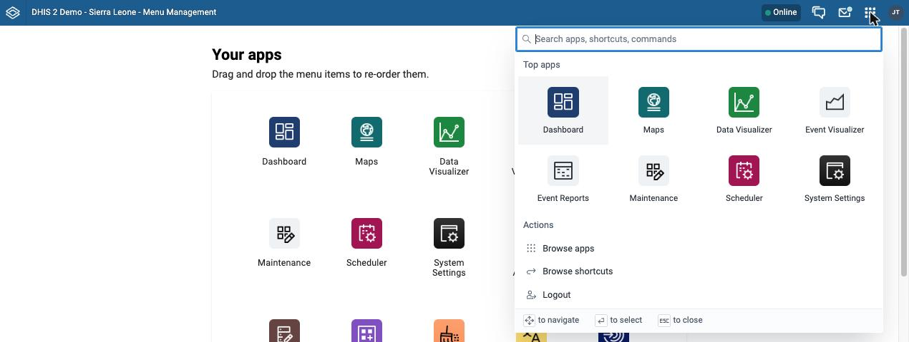

# Menu Management app { #menu_management_app }

The **Menu Management** app changes the order of the apps in your DHIS2 menu. You drag an app to a new position, and DHIS2 saves the new order for your user account.

This page explains which apps the app lists, how to change the order, and where the new order appears. The app is available in DHIS2 v41 and later.

## What the app shows { #menu_management_app_overview }

The app opens with the heading **Your apps**. Under it is a grid with one icon for each app that you can open, in your current order. The grid includes the **Menu Management** app itself, and apps that an administrator installed in the **App Management** app, such as custom apps.

Keep these points in mind:

-   The order belongs to your user account. When you change the order, no other user sees a change. The app cannot set one default order for all users.
-   The apps are not sorted alphabetically. The order that you see is the order that you set, or the default order of your instance if you have not changed it.
-   If you have changed the order, an app that is installed later appears at the end of your list. DHIS2 does not move new apps into your order, so drag the app to where you want it.
-   The app has no reset button. To go back to an earlier order, drag the apps back to their old positions.

## Change the order of your apps { #menu_management_app_reorder }

Before you start, make sure that one of your user roles has the **Menu Management app** authority. An administrator sets user roles in the **Users** app. Users with all authorities, or with the **App Management app** authority, can also open the app.

1. Open the **Menu Management** app. To find it, open the command palette and search for **Menu Management** (see [Command palette](#command_palette)).
2. Find the app that you want to move.
3. Drag the app to its new position, and drop it. The other apps move to make room for it.
4. Check that the message **Updated order of apps.** appears. DHIS2 saves the order each time that you drop an app, so you do not need to click a save button.
5. Refresh your browser page to see the new order in the header bar.

If you move more than one app, repeat steps 2 to 4 for each app. Do the refresh in step 5 once, after the last move.

## Where the new order appears { #menu_management_app_where }

The order that you set decides which apps the header bar shows first.

#### v41 { #menu_management_app_v41 }

In v41, the order of the apps in the apps menu of the header bar follows the order in the Menu Management app.

#### v42 and later { #menu_management_app_v42_and_later }

From v42, the command palette shows the first eight apps in your order as **Top apps**. To see the other apps, choose **Browse apps**. For more about the command palette, see [Command palette](#command_palette).

To keep the apps that you use most in the **Top apps** grid, drag them into the first eight positions.

## Troubleshooting { #menu_management_app_troubleshooting }

Table: Problems with the Menu Management app

| Problem                                                                                            | Cause                                                                                                                                                          | Solution                                                                                                          |
| -------------------------------------------------------------------------------------------------- | -------------------------------------------------------------------------------------------------------------------------------------------------------------- | ----------------------------------------------------------------------------------------------------------------- |
| The header bar still shows the old order after you moved an app.                                   | The header bar reads your order when the page loads.                                                                                                           | Refresh your browser page.                                                                                        |
| The message **Something went wrong whilst loading your apps** appears with an error text under it. | The app could not load the list of apps from the server.                                                                                                       | Read the error text, check your connection, and refresh the page. If the error stays, contact your administrator. |
| An error message appears after you drop an app.                                                    | The server did not save the new order.                                                                                                                         | Try the move again. If the error stays, contact your administrator.                                               |
| An app that you expect is not in the list.                                                         | The list shows only the apps that your user account can open. Each app needs its own authority in one of your user roles, for example **Menu Management app**. | Ask an administrator to add the authority for the app to your user role in the **Users** app.                     |

## Related topics { #menu_management_app_related }

-   [Command palette](#command_palette)
-   [Users](#users_app)
